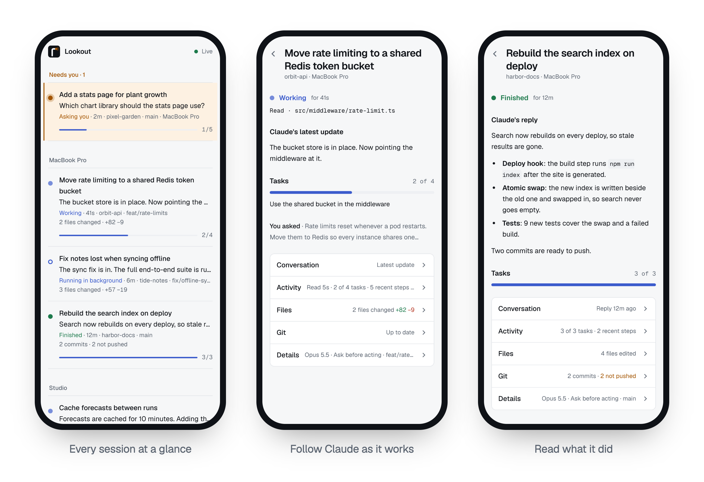
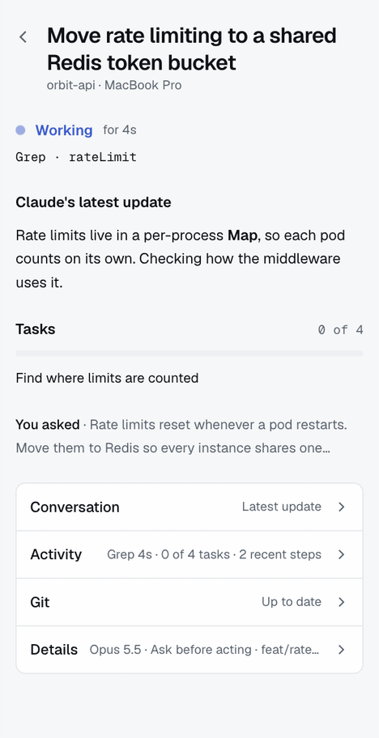
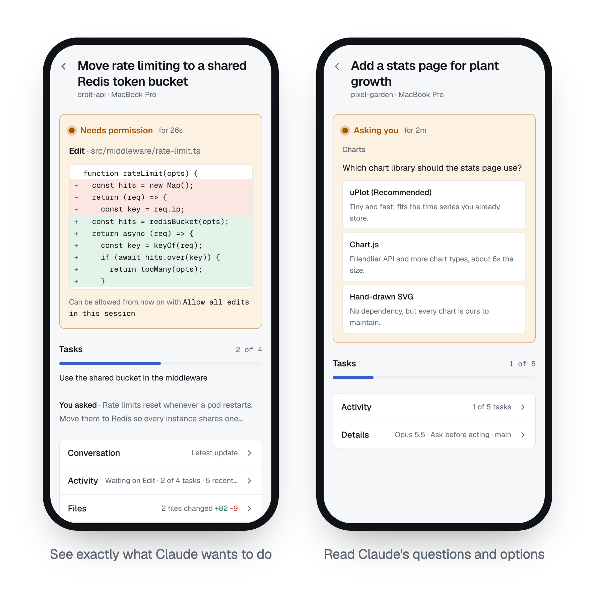
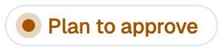
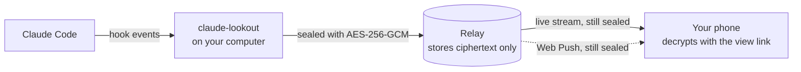

<div align="center">


# claude-lookout

**Walk away from your desk. Lookout tells you when Claude needs you.**<br>
Follow your local Claude Code sessions from your phone: read-only, end-to-end encrypted, no Claude login, and nothing moved to the web.

<p>
  <a href="https://www.npmjs.com/package/claude-lookout"></a>
  <a href="https://github.com/rayan-mansoor/claude-lookout/actions/workflows/check.yml"></a>
  
  
  <a href="LICENSE"></a>
</p>

<p>
  <a href="#quick-start"><b>Quick start</b></a> ·
  <a href="#why-not-remote-control">Why not Remote Control?</a> ·
  <a href="#how-it-works">How it works</a> ·
  <a href="#privacy">Privacy</a> ·
  <a href="#hosting">Hosting</a> ·
  <a href="#faq">FAQ</a>
</p>

<br>

<picture>
  <source media="(prefers-color-scheme: dark)" srcset=".github/assets/hero-dark.png">
  
</picture>

</div>

<table>
<tr>
<td width="33%" valign="top">

**Step away while Claude works**<br>
Your phone shows every session as it runs, then tells you the moment one needs you or finishes.

</td>
<td width="33%" valign="top">

**No Claude login on your phone**<br>
The view link is the only key, so a shared Claude account stays private and any plan works.

</td>
<td width="33%" valign="top">

**Your session stays in your terminal**<br>
Nothing moves to the web. Only encrypted state leaves your machine, and only your view link opens it.

</td>
</tr>
</table>

Give Claude a long task and go make coffee. Lookout follows each Claude Code session from your phone: what Claude is doing right now, how far through its tasks it is, and what it said when it finished. The moment a session needs a permission, asks you a question or wants a plan approved, your phone buzzes, so you walk back to your keyboard only when it matters.

## Quick start

Run this once on each computer that runs Claude Code:

```sh
npx claude-lookout setup
```

1. **Setup shows the exact change** it will make to `~/.claude/settings.json`, backs the file up, and adds claude-lookout's hooks. That is the whole installation.
2. **Scan the QR code** it prints, or open the view link on your phone. The dashboard remembers it from then on.
3. **Tap Turn on** to get notifications when a session needs you or finishes.

> [!TIP]
> Add the dashboard to your Home Screen to use it like an app. On iPhone and iPad this is also what makes notifications possible.

Nothing runs in the background and nothing starts at login. When Claude Code starts a session, its hooks wake claude-lookout, and it goes back to sleep a few minutes after your last session closes.

To open the dashboard on your phone away from home, put it behind a relay or Tailscale; see [Hosting](#hosting).

## Follow a session from start to finish

<table>
<tr>
<td width="44%" align="center">
<picture>
  <source media="(prefers-color-scheme: dark)" srcset=".github/assets/journey-dark.gif">
  
</picture>
</td>
<td>

**Watch it work.** Claude's latest update as it goes, the step it is on, task progress, and recent steps with how each one went.

**Read what it did.** Claude's reply, formatted as it wrote it, the files it changed and the commits it made.

**Know when it needs you.** Permission requests, questions and plans to approve rise to the top of the list, and your phone gets a notification.

**See every computer at once.** Sessions from all your machines on one screen, each with how long it has been in its state.

</td>
</tr>
</table>

## When Claude needs you

<div align="center">
<picture>
  <source media="(prefers-color-scheme: dark)" srcset=".github/assets/needs-you-dark.png">
  
</picture>
</div>

A session that stops for you moves to the top of the list and your phone gets a notification. Open it to see exactly what Claude is waiting on: the command it wants to run or the lines of the edit it wants to make, its question with every option, or the plan it wants approved. Then answer at your keyboard, knowing what you are walking back to.

## Why not Remote Control?

Claude Code's [Remote Control](https://code.claude.com/docs/en/remote-control) lets you drive a local session from claude.ai/code or the Claude app. It is built for continuing the work, and that comes with requirements that don't suit a quick look:

|                              | Remote Control                                                            | claude-lookout                                        |
| ---------------------------- | ------------------------------------------------------------------------- | ----------------------------------------------------- |
| Viewer signs in              | With the same Claude account and organization                             | Never, the view link is the credential                |
| Plans                        | Pro, Max, Team or Enterprise; API keys and LLM gateways are not supported | Any way you run Claude Code                           |
| Where the conversation goes  | Stored on Anthropic's servers while connected                             | Stays on your machine; only encrypted state leaves it |
| Who else can see the session | Anyone using that Claude account                                          | Only people holding your view link                    |
| Can drive the session        | Yes                                                                       | No, it is view-only                                   |

If you share a Claude account, or you just want to know when Claude needs you without handing the session to a web client, claude-lookout is the lighter tool.

## What you see

Every open Claude Code session shows one of these states, with how long it has been in it:

| State                                                                                                                                                                                                             | Meaning                                                                        |
| ----------------------------------------------------------------------------------------------------------------------------------------------------------------------------------------------------------------- | ------------------------------------------------------------------------------ |
| <picture><source media="(prefers-color-scheme: dark)" srcset=".github/assets/states/ready-dark.png"></picture>                           | Open, nothing asked yet                                                        |
| <picture><source media="(prefers-color-scheme: dark)" srcset=".github/assets/states/working-dark.png"></picture>                     | Claude is running                                                              |
| <picture><source media="(prefers-color-scheme: dark)" srcset=".github/assets/states/background-dark.png"></picture> | The run ended, but Claude continues by itself once its background tasks report |
| <picture><source media="(prefers-color-scheme: dark)" srcset=".github/assets/states/permission-dark.png"></picture>      | Claude is waiting for you to allow a tool                                      |
| <picture><source media="(prefers-color-scheme: dark)" srcset=".github/assets/states/question-dark.png"></picture>                | Claude asked a question and waits for your answer                              |
| <picture><source media="(prefers-color-scheme: dark)" srcset=".github/assets/states/plan-dark.png"></picture>                   | Claude finished a plan and waits for your approval                             |
| <picture><source media="(prefers-color-scheme: dark)" srcset=".github/assets/states/finished-dark.png"></picture>                  | The run ended and Claude waits for your next prompt                            |
| <picture><source media="(prefers-color-scheme: dark)" srcset=".github/assets/states/interrupted-dark.png"></picture>         | The run was stopped before it finished                                         |
| <picture><source media="(prefers-color-scheme: dark)" srcset=".github/assets/states/closed-dark.png"></picture>                        | The session ended (kept on screen for 30 minutes)                              |

Alongside the state, each session carries fields grouped into levels. You choose the highest level that leaves your machine; the default is 2.

| Level       | Fields                                                                                                                                                                                                                                     |
| ----------- | ------------------------------------------------------------------------------------------------------------------------------------------------------------------------------------------------------------------------------------------ |
| 1 · Context | Project, folder, git branch, model, permission mode, effort, how the session started, what Claude is doing now, recent steps and how each one went, running subagents, task progress, errors, commits and file changes made in the session |
| 2 · Content | The conversation's title, your last prompt, Claude's latest update while it works, the permission being requested, Claude's questions and options, the plan to approve, Claude's last message, commit messages                             |

Content fields pass through a secret filter first: API keys, tokens, passwords, private keys and credentials in URLs are masked as `••••`.

## How it works



1. **Claude Code's hooks** report every state change to claude-lookout, which starts on the first hook and stops a few minutes after the last session closes.
2. **claude-lookout** builds a snapshot of your sessions, keeps only the fields your level allows, masks secrets, and seals it with a key derived from your view link.
3. **The relay** passes sealed snapshots and notifications along. It never holds the key, so it can't read them. Without a relay, claude-lookout serves the dashboard itself; see [Hosting](#hosting).
4. **Your phone** holds the view link, so it alone can open what arrives.

## Notifications

Tap **Turn on** on the dashboard to get a notification when a session needs permission, asks a question, has a plan to approve, or finishes. It waits 10 seconds first, so prompts you answer at the keyboard don't also buzz your phone. On a Mac with the lid closed it sends right away, since nobody is at the keyboard. Once you've dealt with a session elsewhere, its notification disappears from your phone.

Notifications use standard Web Push, so they are free and need no app. Two requirements:

- The dashboard must be on HTTPS (a relay or Tailscale; plain `localhost` works on the same computer).
- On iPhone and iPad, add Lookout to the Home Screen first (Share, then Add to Home Screen) and turn notifications on from there.

Notification text is end-to-end encrypted like everything else: the relay forwards a sealed message, and your device decrypts it with the view link it already holds.

## Privacy

- **The view link is the credential.** Its secret sits after the `#` in the URL, which browsers never send to a server. Anyone holding the link can see your sessions; nobody else can.
- **Everything is end-to-end encrypted.** Each snapshot is sealed with AES-256-GCM using a key derived from the view secret before it leaves your machine. The server that passes it on stores only ciphertext, the space's random id, and hashes of the access tokens.
- **Viewers can't write.** Machines publish with a separate secret that never appears in the view link, so a viewer can't fake a session.
- **You choose how much leaves.** Set `"level"` in `~/.claude-lookout/config.json` to `1` to share context only (no prompts, questions or messages).
- **Secrets are masked first.** See [What you see](#what-you-see).

> [!IMPORTANT]
> Treat the view link like a password. Share it only with devices you want to see your sessions.

## Hosting

claude-lookout needs somewhere your phone can reach. Pick one:

|                                          | Cloudflare relay (recommended) | Your own server | Directly from your computer |
| ---------------------------------------- | :----------------------------: | :-------------: | :-------------------------: |
| Reachable from anywhere                  |               ✓                |        ✓        |      Through Tailscale      |
| Several computers on one dashboard       |               ✓                |        ✓        |              –              |
| Last known state while a computer sleeps |               ✓                |        ✓        |              –              |
| Cost                                     |       Free Workers plan        |   Your server   |            Free             |

<details>
<summary><b>A relay on Cloudflare</b> (recommended)</summary>

<br>

A small relay on Cloudflare's free Workers plan keeps the dashboard reachable from anywhere, shows several computers side by side, and still shows the last known state when a computer is asleep ("Offline · last seen 12m ago"). It only ever holds encrypted data.

Deploy your own once (needs a free Cloudflare account):

```sh
git clone https://github.com/rayan-mansoor/claude-lookout && cd claude-lookout
npm ci && npm run build
npm run deploy -w @claude-lookout/relay     # prints https://claude-lookout.<you>.workers.dev
npx claude-lookout setup --relay https://claude-lookout.<you>.workers.dev
```

Setup then prints a view link on your relay, plus a `setup --join …` command. Run that command on any other computer to put its sessions on the same dashboard.

Free-plan limits are far above what one person needs: each computer sends a small update when something changes and a heartbeat every 30 seconds, and the dashboard only holds a connection open while it is on screen.

</details>

<details>
<summary><b>A relay on your own server</b></summary>

<br>

Any always-on machine with Node.js can run the same relay:

```sh
npx claude-lookout relay --port 8787
```

Put it behind HTTPS (Caddy, nginx or a Cloudflare Tunnel all work), then run `npx claude-lookout setup --relay https://<your-server>` on each computer. The relay stores only encrypted data, in `~/.claude-lookout/relay.json` by default (`--data` to change it).

</details>

<details>
<summary><b>Directly from your computer</b></summary>

<br>

Without a relay, the dashboard is served by claude-lookout itself, on `http://localhost:4777`, while Claude Code runs. That works as-is on the same computer. To open it from your phone, make that address reachable:

- **Tailscale** (private to your devices): run `tailscale serve --bg 4777`, then `npx claude-lookout setup --url https://<your-machine>.<your-tailnet>.ts.net`. Tailscale provides HTTPS, which phones need for notifications and to install the dashboard as an app.
- **Your local network**: `npx claude-lookout setup --host 0.0.0.0 --url http://<your-machine>.local:4777`. Only use this on networks you trust.

When Claude Code isn't running, claude-lookout isn't either, so this dashboard is offline too.

</details>

## Commands

| Command                        | What it does                                             |
| ------------------------------ | -------------------------------------------------------- |
| `npx claude-lookout setup`     | Connect claude-lookout to Claude Code (once per machine) |
| `npx claude-lookout link`      | Show the view link and QR code again, for another device |
| `npx claude-lookout status`    | Show the sessions open on this machine                   |
| `npx claude-lookout relay`     | Run your own relay on this server                        |
| `npx claude-lookout uninstall` | Disconnect claude-lookout from Claude Code               |

`npx claude-lookout --help` lists every option.

## FAQ

<details>
<summary><b>Can I approve permissions or answer Claude from my phone?</b></summary>

<br>

Not today. claude-lookout is view-only by design: it tells you when Claude needs you and shows you exactly what for, and you answer at your computer.

</details>

<details>
<summary><b>Does it cost anything?</b></summary>

<br>

No. The Cloudflare relay fits easily in the free Workers plan, Web Push is free, and running directly from your computer needs no server at all. claude-lookout makes no model calls, so it uses none of your Claude usage.

</details>

<details>
<summary><b>Does anything keep running when I'm not using Claude Code?</b></summary>

<br>

No. There is no background service and nothing starts at login. Claude Code's hooks start claude-lookout, and it exits a few minutes after your last session closes.

</details>

<details>
<summary><b>Can I watch several computers on one dashboard?</b></summary>

<br>

Yes, with a relay. Setup prints a `setup --join …` command; run it on each other computer and their sessions appear side by side, with whatever needs you from any of them listed first.

</details>

<details>
<summary><b>How do I remove it?</b></summary>

<br>

```sh
npx claude-lookout uninstall
```

This removes claude-lookout's hooks from Claude Code's settings (again showing the change and keeping a backup). Delete `~/.claude-lookout` to remove its config and view link as well.

</details>

## License

[MIT](LICENSE)

> [!NOTE]
> claude-lookout is an independent open-source project. It is not affiliated with, endorsed by or supported by Anthropic. "Claude" and "Claude Code" are trademarks of Anthropic.
